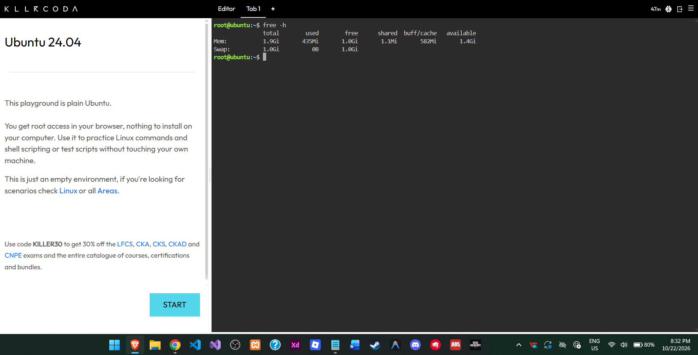
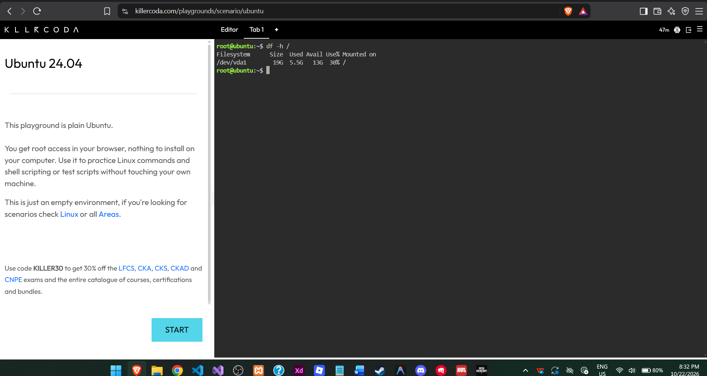

# 🖥️ System Baseline Report

## 🧠 1. Memory (RAM) Usage

- **Total RAM:** 1.9Gi
- **Command Used:** `free -h`

## 💾 2. Disk Storage

- **Total Root File System Storage:** 19G
- **Command Used:** `df -h /`

## ⚙️ 3. CPU Load and Running Processes

- **Command Used:** `top`
- **Observation:** The `top` command displays active running processes, CPU utilization, memory usage, and system load.

## ⚠️ 4. Importance of Checking Disk Space

Checking disk space before a massive traffic surge is critical because insufficient storage can cause application failures, prevent logs from being saved, and affect server performance.

## 📸 5. Screenshots

### 🧠 Memory Check

### 💾 Disk Check

