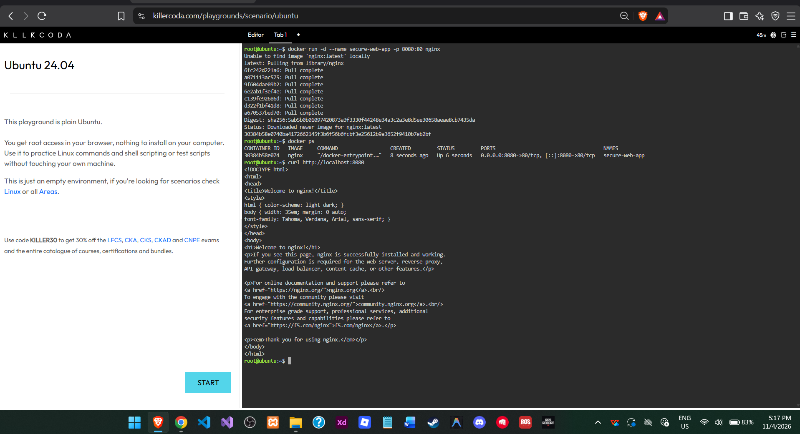
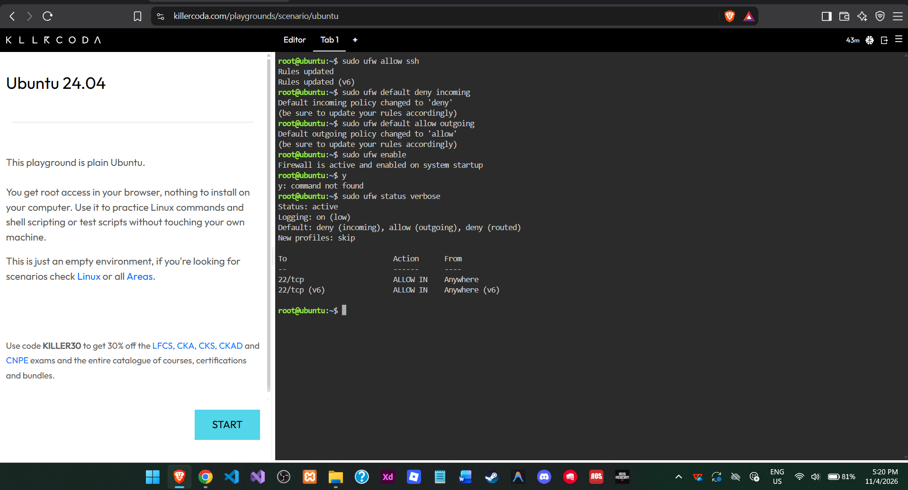
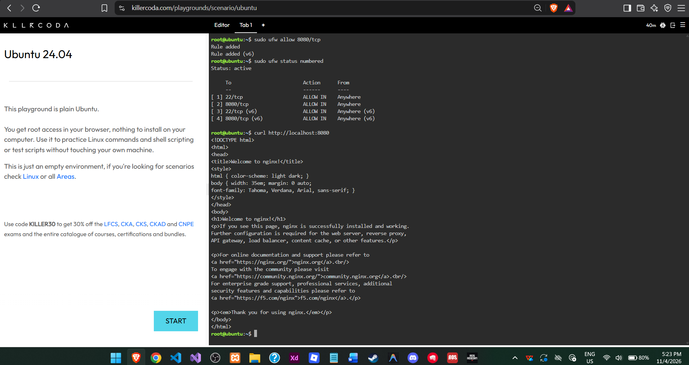

# 🔐 Laboratory-08: Cloud Security Engineer

## 🎯 Mission Overview

Congratulations! Your proactive approach to system monitoring has earned you a spot on the elite  
**Cloud Security Team** at CloudNova Technologies.  
In the cloud, leaving a server unsecured for even a few minutes can lead to automated brute-force  
attacks and data breaches. Your mission today applies the security concepts you learned in Chapter 8. You will  
implement the principle of defense in depth by locking down a live server using a host-based firewall.  
Using the KillerCoda Playground, you will step into the role of a Cloud Security Engineer. You will  
deploy a web application, audit the server's open ports, and configure the Uncomplicated Firewall (UFW) to block  
malicious traffic while allowing legitimate users to access the application.  
Remember: **Security is not a product you buy; it is a continuous process you maintain.**

## 🎯 Objectives

At the end of this laboratory activity, you should be able to:

- Understand the concept of the Attack Surface and the Principle of Least Privilege (PoLP).
- Perform a basic security audit of active network ports on a Linux server.
- Configure the Uncomplicated Firewall (UFW) with a Default Deny policy.
- Implement granular port management to selectively allow SSH and HTTP traffic.
- Document firewall rules and security best practices using Markdown.
- Continue expanding your professional GitHub Cloud Computing Portfolio.

Using the KillerCoda Playground, you will step into the role of a Cloud Security Engineer. You will deploy a web application, audit the server's open ports, and configure the Uncomplicated Firewall (UFW) to block malicious traffic while allowing legitimate users to access the application.

Remember: Security is not a product you buy; it is a continuous process you maintain.

## ⚙️ Commands Executed

### 🐳 Deploy Web Application
```bash
docker run -d --name secure-web-app -p 8080:80 nginx
docker ps
curl http://localhost:8080
```

### 🔑 Allow SSH
```bash
sudo ufw allow ssh
```

### 🚫 Configure Default Policies
```bash
sudo ufw default deny incoming
sudo ufw default allow outgoing
```

### 🔓 Enable Firewall
```bash
sudo ufw enable
```

### 🌐 Allow Web Application Port
```bash
sudo ufw allow 8080/tcp
```

### 🔍 Verify Firewall
```bash
sudo ufw status verbose
sudo ufw status numbered
curl http://localhost:8080
```

## 🧠 Skills Learned

- Understanding the Principle of Least Privilege (PoLP).
- Identifying and reducing the attack surface of a Linux server.
- Deploying an Nginx web application using Docker.
- Configuring UFW firewall rules and default policies.
- Allowing specific network ports while blocking unauthorized incoming traffic.
- Verifying application accessibility using curl.
- Documenting security configurations using Markdown.
- Practicing basic cloud server security and defense in depth.

## 📸 Screenshots

### 🚀 Vulnerable Application Running


### 🔥 Firewall Activated


### 🌐 Firewall Port Allowed

