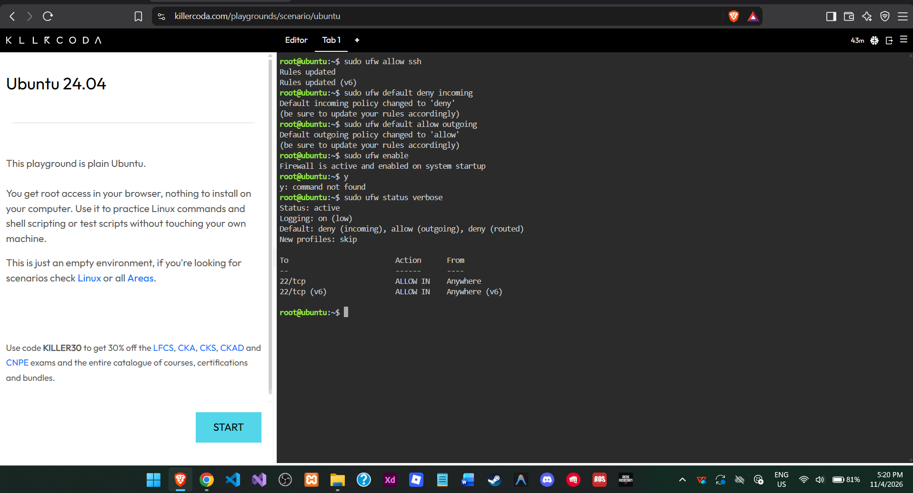
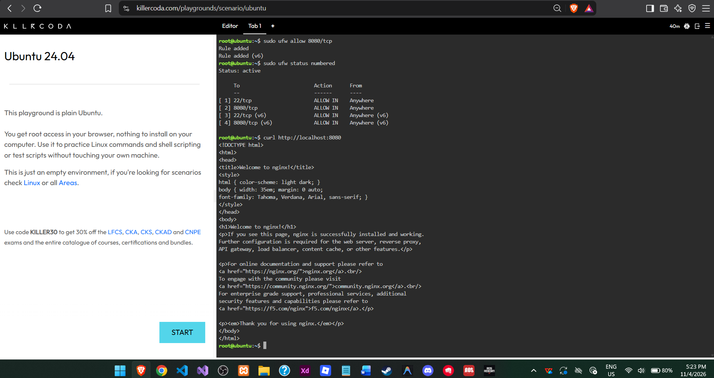

# 🔥 Firewall Configuration

## 🛡️ Firewall Security Commands

### 🔑 Allow SSH Access
```bash
sudo ufw allow ssh
```
Allows SSH connections through port 22 so administrators can remotely manage the server.

### 🚫 Set Default Deny Policy
```bash
sudo ufw default deny incoming
sudo ufw default allow outgoing
```
Blocks all incoming connections by default while allowing outgoing traffic.

### 🌐 Allow Port 8080
```bash
sudo ufw allow 8080/tcp
```
Allows incoming TCP traffic on port 8080 so users can access the Nginx web application.

### 🔓 Activate Firewall
```bash
sudo ufw enable
```
Enables the firewall and applies the configured security rules.

### 🔍 Verify Firewall Status
```bash
sudo ufw status verbose
sudo ufw status numbered
```
Displays the firewall status, default policies, and configured rules.

## ⚠️ SSH Security Warning
If you run `sudo ufw enable` before `sudo ufw allow ssh`, incoming SSH connections may be blocked, potentially locking administrators out of their remote server.

## 📸 Screenshots
- 
- 
