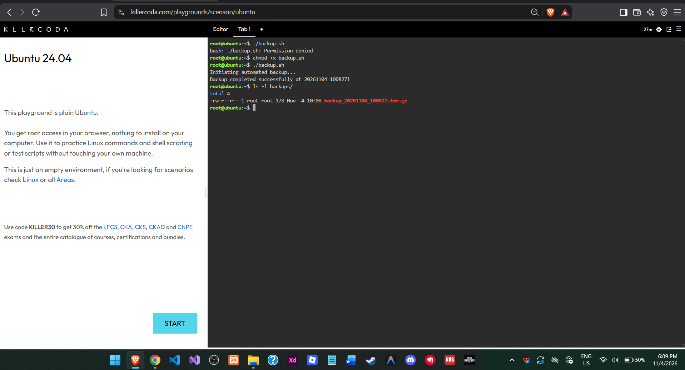
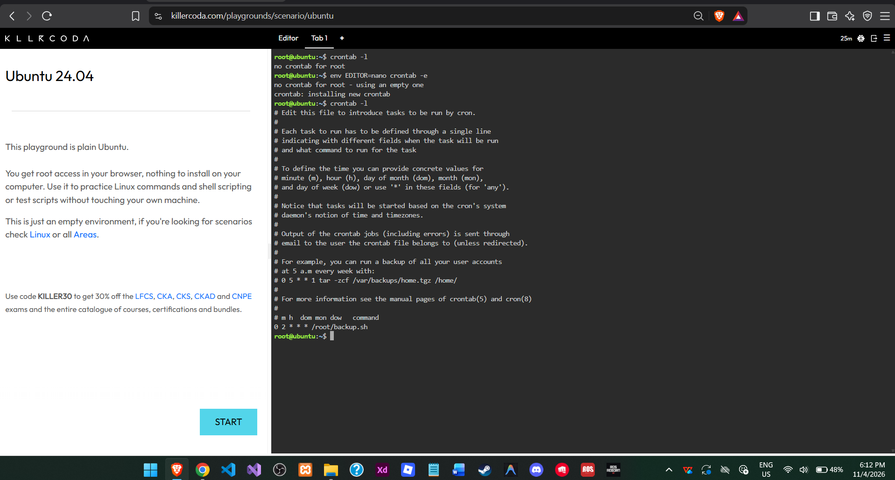

# 🤖 Backup Script Guide

## 📚 Checkpoint 6 - Technical Documentation

### 📝 1. Backup Script Code

The following Bash script automatically compresses the client data folder into a timestamped backup file.

```bash
#!/bin/bash
# Automated Backup Script for CloudNova Technologies
SOURCE_DIR="app-data"
BACKUP_DIR="backups"
TIMESTAMP=$(date +"%Y%m%d_%H%M%S")
echo "Initiating automated backup..."
# Create the backup directory if it does not exist
mkdir -p $BACKUP_DIR
# Compress the source directory into a tarball (.tar.gz)
tar -czf $BACKUP_DIR/backup_$TIMESTAMP.tar.gz $SOURCE_DIR
echo "Backup completed successfully at $TIMESTAMP!"
```

### 🔓 2. File Permissions

The `chmod +x backup.sh` command grants execution permission to the backup script. This allows Linux to run the script as a program using `./backup.sh` instead of treating it as a regular text file.

### ⏰ 3. Cron Job Configuration

The cron expression used to schedule the automatic backup is:

```bash
0 2 * * * /root/backup.sh
```

#### 🕒 Cron Time-Field Breakdown

| Field | Value | Meaning |
|---|---|---|
| Minute | `0` | At minute 0 |
| Hour | `2` | At 2 AM |
| Day of Month | `*` | Every day of the month |
| Month | `*` | Every month |
| Day of Week | `*` | Every day of the week |

This schedule runs the backup script every day at exactly 2:00 AM.

### 📸 Screenshots




